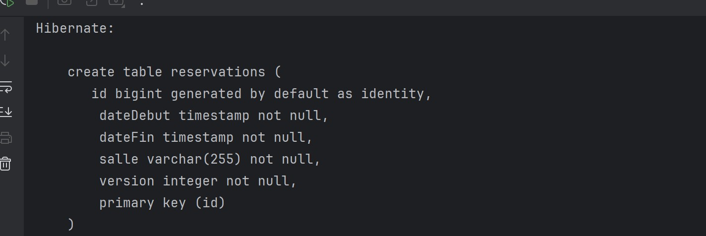
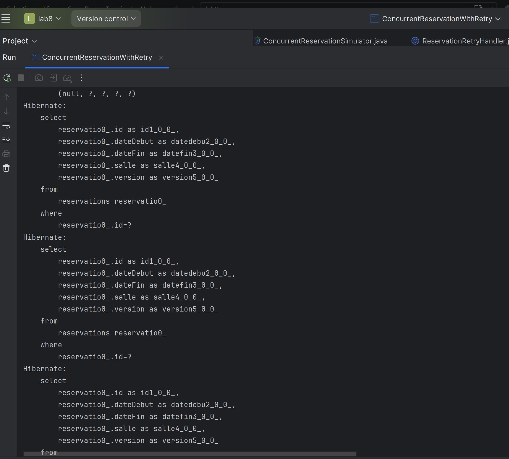
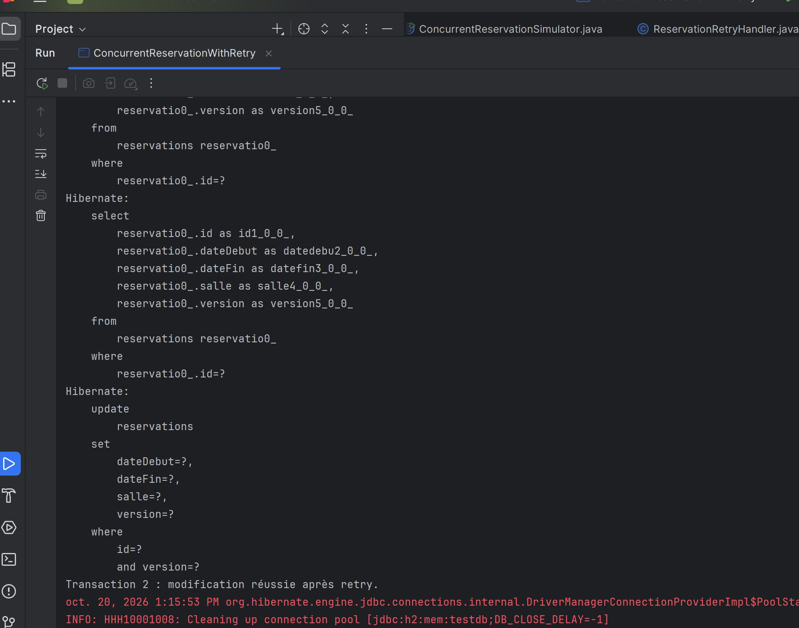

# TP 8 — Verrouillage optimiste avec JPA

Ce TP utilise JPA, Hibernate et H2 pour gérer les conflits de modification des réservations avec `@Version` et une stratégie de retry.

## Création de la table

Hibernate crée la table `reservations` avec le champ `version` nécessaire au verrouillage optimiste.

## Lecture des réservations

Les requêtes SELECT chargent la réservation et sa version pour simuler les modifications de deux utilisateurs.

## Modification après retry

La deuxième transaction réussit après retry grâce au rechargement de la réservation et à une mise à jour vérifiant sa version.

